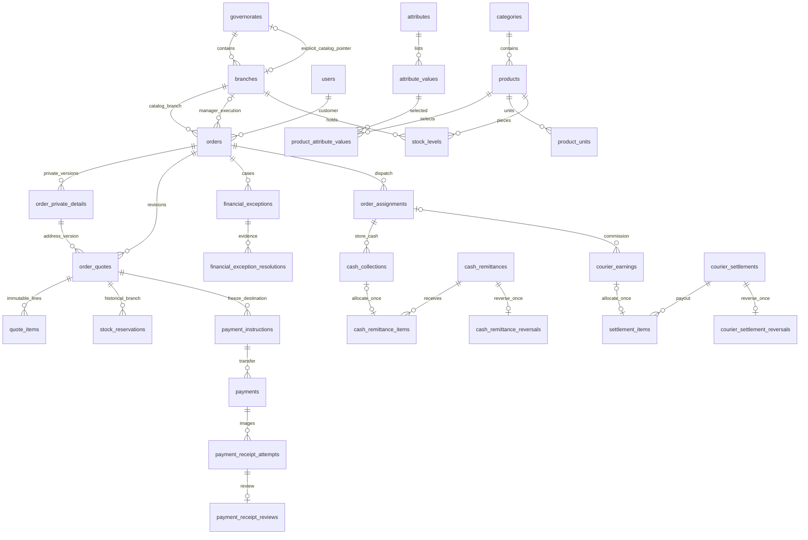

# إغلاق تصحيحات مراجعة المرحلة00

مصدر الاعتماد: [قرارات المالك](OWNER_DECISIONS_PHASE00.md)، المؤرخ 29 أكتوبر2026. هذا التقرير يحل محل توصيات المراجعة الأولى المخالفة؛ [المراجعة الأولى](backend/docs/progress/phase-00-initial/REVIEW_00.md) محفوظة كتاريخ. لم تبدأ01 ولم تنشأ migrations إنتاجية أو خدمات أو واجهات.

## النتيجة الحالية

وُحّدت المتطلبات والقرارات والعقود وقواعد العمل والمخطط المرجعي والاختبارات وفق حلول المالك. المخطط الحالي69 جدولًا بدل56، بإضافة13 جدولًا لفصل خصوصية الطلب وتعليمات التحويل ومحاولات الإيصال ومراجعاتها وإعادة التحقق والإلغاء والاستثناءات والعكس والتحصيل النقدي وتوريده. توجد حراس بيانات مرجعية مختبرة؛ هذه ليست APIs أو خدمات تعمل فعليًا.
تتبع كل F01–F11 والقرارات الجديدة وحالات الانتظار في [ISSUES.md](ISSUES.md)، والتتبع التجاري التفصيلي D01–D21 في [DECISIONS.md](DECISIONS.md). تقرير التنفيذ الحالي [phase-00.md](backend/docs/progress/phase-00.md) ودليل الفحوص [phase-00-checks.json](backend/docs/progress/phase-00-checks.json).

## القواعد التي حسمها المالك وما تغير

| المصدر | القرار النافذ | الملفات والدليل |
|---|---|---|
| أولًا1–3 | المدير يحدد فرع التنفيذ، وكتالوج فرع المحافظة وأسعاره دون اختيار آلي/تجميع؛ تغيير الفرع يقبله العميل دائمًا | REQUIREMENTS/DECISIONS/BUSINESS_RULES/API؛ catalog_branch_id مقابل branch_id؛ O13/O14/O36. |
| أولًا4–5 | floor_km فقط، وسعر يدوي مسبب عند فشل الطريق؛ حدود التغطية لا تفترض | delivery_rules/order_quotes/branches؛ O01–O04/O35/O48. |
| أولًا6 | تحويل يدوي ونقد عند الاستلام؛ لا تحويل مسبق مطلوب للنقد ولا paid بالتأكيد | payment_kind وحارس التأكيد، payment_instructions/attempts/reviews، cash_collections/remittances؛ O06–O10/O29/O30/O38/O39. |
| أولًا7–8 | حجز أولي30 دقيقة؛ الإيصال يحمي المخزون وتسعيرة التحويل حتى المراجعة دون مهلة آلية؛ النقد يعاد التحقق له | stock_reservations.hold_kind وquote_revalidations؛ O21/O24/O25/O42؛ expiry worker والتحقق الحي لاحقًا. |
| أولًا9–10 | إلغاء مباشر دون إيصال قبل التأكيد ومراجعة بعده، وملغي حالة مستقلة؛ مبلغ المؤكد ثابت | order_cancellation_requests وحراس orders/quotes؛ O26–O28. |
| أولًا11 | تسوية خارجية موثقة للزائد والمتأخر والتعذر، لا استرداد آلي | financial_exceptions/resolutions؛ O34/O43/O44؛ الدليل والمرجع والمبلغ والمسؤول والتاريخ مطلوبة. |
| أولًا12 | العمولة قبل خصم التوصيل وتستحق مرة عند التسليم؛ النقد مستقل | order_assignments/earnings/settlements/reversals؛ O05/O31–O33/O45–O47. |
| أولًا13 | عرض واحد بأكبر توفير، لا جمع ولا retail تلقائي مع الجملة | promotion_id/snapshot واحد؛ O11/O12 يمنعان الجمع؛ حساب الأكبر والتعادل saving DESC ثم id ASC معايير خدمات لاحقة. |
| أولًا14 | صيانة العميل تستثني الطلب الجاري والدعم والخصوصية والحذف؛ المدير والموصل مستمران | BUSINESS_RULES/API/SECURITY_OPERATIONS/ACCEPTANCE ووثائق الشاشات؛ لم ينفذ middleware الآن. |
| ثانيًاF01–F11 | إصلاح المرجع مع تمييز الخدمات اللاحقة؛ F11 وقت التهيئة | ISSUES، المخطط والقاموس المولد وخطة المراحل؛ الفيديوهات باقية في video دون إعادة توليد أو تكرار. |
| ثالثًا | لا اعتماد عام للمقترحات المركبة أو إعدادات الخدمات أو مدد الاحتفاظ والنسخ | D01–D21 بحالات معتمد/جزئي/مقترح/مؤجل؛ Q01–Q06 في ISSUES. |

## المخزون والحبة والكرتون والخصائص

الحبة رصيد موحد لكل SKU وفرع؛ الكرتون تحويل ثابت مستقل السعر. 2×12+3=27 من رصيد واحد، و26 لا تكفي (O41). تحفظ الوحدة والاسم والخصائص والسعر والتحويل في بنود العرض. لا تغيير تحويل له استعمال؛ تؤرشف الوحدة وتنشأ أخرى (O19). الخصائص قوائم مرتبطة بالقسم والقيمة الصحيحة وليست نصوصًا حرة؛ المفاتيح والتفرد اختبرت ضمن S01–S22.
مجموع الحجز والرصيد والدفتر وصرف27 مرة واحدة ومعاملات النقل والجرد وأقفال التنافس تنفذ لاحقًا بالخدمات. required attributes ونشاط القيم ودورات الأقسام تبقى SV01/SV03. لا توهم اختباراتSQL أن هذه الخدمات مكتملة.

## دورة الطلب والقبول والحجز

المعاينة حساب تقديري غير حاجز. submit يحفظ الطلب المرسل وبنوده والعنوان وفرع ما شاهده العميل وينتظر المدير. معاملة إصدار العرض اللاحقة على ذلك الطلب تجمع اختيار الفرع وإصدار العرض النهائي والحجز وoutbox. بذلك لا يفترض HTTP العميل قرار المدير ولا ينشئ quote يشير لطلب غير موجود.
المدير يحدد التنفيذ صراحة؛ التغيير يولد revision ويحرر الحجوزات القديمة دون محوها، ثم يحجز في الفرع الجديد. يبقى فرع الكتالوج الأصلي وسابق القبول، ويحتاج العرض الجديد موافقة حتى تساوي الإجمالي. حارس immutable لا يحظر status أو قبولًا صحيحًا، بل يحفظ الحقائق التاريخية ويمنع محو أثر قبول عند superseded/expired.
الحجزtimed30 دقيقة، ثم إذا رُفع إيصال على حجز صالح يصبح receipt_review دون expires_at؛ لا تنتهي تسعيرة التحويل أو حجزها لمجرد مرور30 دقيقة. رفض صورة ليس نفيًا لوصول المال ولا قرار تحرير آلي؛ تسجل النتيجة ثم إجراء حجز إداري مسبب. التحويل المتأخر بلا حجز يتحول إلى استثناء قابل للتسجيل، ولا يولد مخزونًا منعدمًا. مسار النقد يعيد فحص نفس السعر والحجز قبل التأكيد إذا انتهيا، أو يصدر عرضًا جديدًا إذا تغير شيء.

## الدفع والعمولة وتحصيل النقد

التحويل: تعليمات المستفيد والرقم محفوظة قبل إظهارها، ثم transfer واحدة وصور ومراجعات متسلسلة؛ إعادة صورة لا تضاعف المال أو الحجز، ومرجع الوسيلة لا يستعمل لطلب آخر. approved_amount هو المبلغ المتحقق منه خارجيًا، والتأكيد يتطلب صافيًا مطابقًا بعد أي تسويات خارجية موثقة.
النقد: لا إيصال أو تحويل شرطًا للتأكيد؛ يلزم القبول والفرع والحجز. لا collection تلقائية عند التأكيد أو التسليم. collection فعلية أو استثناء نقص/تعذر يسبق delivered، والتوريد للإدارة مستقل عن earning. عمولة المثال500−خصم100 عند20% تساوي100، ورسوم العميل400؛ يثبت الأساس والنسبة عند الإسناد.
تسويات العمولات وتوريدات النقد لكل منها رأس وبنود متطابقة ومالك صحيح وتخصيص مرة واحدة. عكس الأصل سجل موثق فريد وcredit قابل للتخصيص مرة، دون محو allocation أو خلق عمولة جديدة. الدفاتر append-only، والتصحيح بالقيود التعويضية.

## الخصوصية والحدود التشغيلية

العنوان والتواصل في order_private_details منفصلان عن الحقائق المالية. التعمية أحادية الاتجاه بعد الالتزامات وبسياسة معتمدة مع تدقيق بلا نسخ بيانات محذوفة؛ لا UPDATE عام للدفاتر. تنفيذ الحذف وقيود DBrole/API والمدد في05/11، ولم يقرر المخطط مدة قانونية أو يشغل خدمة حذف.
NULL في إعداد التغطية لا يسمح بالتوصيل المفتوح؛ التفعيل يتطلب نطاقًا وحد طريق وتعرفة. القيم الفعلية ومزود Routing وOTP/R2/Expo/Push والعمولات وأرقام المستفيدين لم تهيأ. لا يمنع ذلك إنهاء مرجع00 أو بناء واجهات تجريبية بعد طلبها.

## خريطة العلاقات الحالية المختصرة

العلاقات في الرسم مختصرة؛ source واحد في كل allocation قد يكون قيدًا أو credit عكس وفق CHECK. القاموس الكامل للحقول وFK وCHECK والـtriggers في [DATABASE.md](backend/docs/DATABASE.md) مولد من PostgreSQL نفسه، ومطابقته قابلة للفحص لتجنب تكرارF07.

## وضع F01–F11 وخطة ما بعد00

| الحالة | الملاحظات | ما ينفذ لاحقًا |
|---|---|---|
| حراس/نموذج مرجعي مصحح ومختبر | F02/F03/F04/F05/F06/F07/F09 وجزء البيانات منF10 | migrations وصلاحيات DB والخدمات في05–11 عند طلب مراحلها. |
| عقد/تدفق مرجعي موحد | F01/F08 وبقية قواعد الخدمة فيF09/F10 | OpenAPI وخدمات preview/submit/quote وidempotency والمخزون/التحصيل/الصيانة/الحذف واختبارات التزامن. |
| مؤجل صراحة لوقت التهيئة | F11 | عند01 مواءمة require وإخراج إعادة التصدير إلى video، دون تجديد أصل أو تكراره. |

المقترحات/القيم المؤجلة لا تعاد كأن المالك اعتمدها كلها: D15 منطقة اليوم، تفاصيل D16، D19 سياسة الاحتفاظ، D20 النسخ وRPO/RTO والميزانية، وبيانات الخدمات والتغطية والنسب الفعلية. لا سياسة تلقائية لتعدد الفروع في المحافظة. السجل الدائم ISSUES يبلغ عنه في كل متابعة ويحدّث عند حلول المالك.

## الاختبارات وحدود الإغلاق

نتيجة التنفيذ الحالية: **73 حالة قيود/حراس ناجحة، وفحصاوقت ناجحان، وأربعة تشخيصات لحدود الخدمات**، مع69 جدولًا و48 trigger صريحًا. جميعها في بيئة SQL معزولة.

نتائج التنفيذ الحالية وأوامرها وبصماتها في تقرير المرحلة ودليل JSON. يشمل الاختبارSQL حراس التحويل والنقد والعرض والعمولة والحجز والتاريخ والخصوصية والتسويات. أربعة تشخيصاتSV توثق حدود الخدمات التي لم تنفذ. مولد القاموس يختبر مطابقة الوثيقة للمخطط الفعلي.
لا typecheck/build أو أجهزة أو API/RBAC أو تزامن PostgreSQL متعدد الاتصالات أو ربط مزود أو قاعدة إنتاج نُفذت؛ لا تنسب نجاحها لهذه المراجعة. أُغلقت تصحيحات مرجع00 وفق الملف المرسل، مع الإفصاح عن F11 المؤجل وواجبات الخدمات والبيانات. **التوقف قبل01 قائم حتى طلبها في رسالة منفصلة.**
