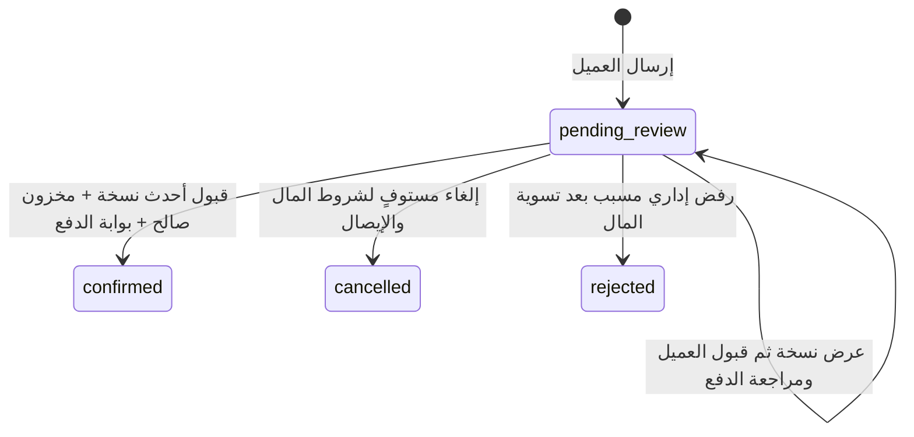

# دورة الطلب المنفذة في08

الخادم وPostgreSQL مصدر السعر والحالة والقبول والحجز والمال. لا دفع تجريبي داخل التطبيقات ولا fallback إلى fixtures. معاينة07 لا تكتب؛ الإرسال يحفظ طلبًا وبنوده وعنوانه الخاص منتظرًا المدير، دون حجز. معاملة إصدار العرض تختار الفرع صراحة، وتحسب السعر والتوصيل والعرض الترويجي الواحد، وتثبت البنود وتحجز30دقيقة مع الأحداث والتدقيق وoutbox.

حالات ما بعدconfirmed والإسناد والنقد والعمولة تنفذ في09. لا يكتب08 في `order_assignments/cash_collections/courier_earnings`.

## المعاملات والنسخ

- كل أمر طلب يتطلب `Idempotency-Key` ثابتًا16–100محرف و`expectedVersion`، باستثناء الإرسال الذي لا يوجد قبله إصدار. يعاد نفس الرد المقتضب لنفس المفتاح والمحتوى؛ المحتوى المختلف409. تحقق الهوية والنطاق يسبق الرد المحفوظ أيضًا. لا DTO خاص أو هاتف أو عنوان في `idempotency_records` أو outbox.
- قفل رأس الطلب ثم قفل الكتالوج المشترك وأقفال المخزون مرتبة؛ تسوية دفتر الحركات والحجوزات والعدادات قبل الكتابة وبعدها. إصدار عرض لآخر مخزون متزامن يسمح بفائز واحد، ولا يترك عرضًا أو حجزًا جزئيًا للخاسر.
- كل عرض مرسل immutable ماليًا. تغيير الفرع أو العنوان أو السعر يولد نسخة جديدة وقبولًا جديدًا، حتى إذا بقي المجموع مساويًا. القبول السابق محفوظ في تاريخ النسخة superseded. لا إصدار جديد فوق حجزreceipt_review.
- العنوان والتواصل داخل `order_private_details`؛ snapshot السعر يشير إلى معرّف النسخة الخاصة ولا يكرر إحداثيات العميل أو الهاتف. تغيير عنوان محفوظ لا يبدل طلبًا قائمًا؛ يختار المدير عنوانًا مملوكًا للعميل في محافظة الطلب عند إصدار نسخة جديدة.
- بعد انتهاء عرض مقبول بلا حماية إيصال، يقارن التأكيد حقائق المنتجات وأسعار المصدر والتعرفة والفرع والطريق والعرض الترويجي من جديد. التطابق يسمح بـquote_revalidation وحجز جديد والتأكيد ذريًا؛ الاختلاف409 ونسخة تحتاج قبولًا. لا تعديل لـsnapshot قديم.

## بوابتا الدفع

| المسار | شرط التأكيد | النتيجة |
|---|---|---|
| التحويل | صافي المال المعتمد والتسويات النقدية الخارجية يساوي إجمالي النسخة المقبولة، ولا استثناء مفتوح أو صورة تنتظر المراجعة، وحجز مطابق | استهلاك الحجز وقيد بيع مرة واحدة؛ لا إعادة اعتماد التحويل |
| النقد عند الاستلام | قبول النسخة والحجز/إعادة التحقق ولا استثناء مفتوح | تأكيد فقط؛ المبلغ مستحق، دون إيصال أو تحويل أو قيد تحصيل/عمولة |

مبالغAPI سلاسل أعداد صحيحة بالريال؛ حسابBigInt. الجملة تحتاج سعرًا صريحًا لكل وحدة، ولا عروض تجزئة. رسم الطريق `base + floor(distance_m/1000)*per_km`؛ فشل المزود/التغطية يحتاج رسمًا يدويًا وسببًا إداريًا، ثم قبول العميل. لا مسافة مستقيمة للتسعير.

## التعليمات والصور والمال

`GET payment-methods` للعميل يعرض الاسم والمعرّف فقط. أمرinstructions يحفظ الجهة والمستفيد والرقم والتعليمات والمبلغ المتوقع قبل إمكان عرضها. تعطيل الوسيلة أو تعديلها لاحقًا لا يعيد كتابة التعليمات الصادرة؛ الإيصال يرتبط بإصدارها.

payment يمثل **تحويلًا واحدًا** برقم مرجعي مطبّع فريد لكل وسيلة عبر كل الطلبات. محاولات الصور والمراجعات مستقلة وappend-only. صورةimage_rejected تقبل صورة جديدة علىpayment نفسه فقط بعد المراجعة؛ لا مبلغ أو حجز إضافي. media خاص ومتحقق ومملوك للعميل، ولا يعاد استعمال معرّفه لمحاولتين. transfer_verified يثبت مبلغًا موجبًا مرة واحدة؛ الصورة لا تثبت المال وحدها.

أول إيصال على حجز صالح يحوله إلىreceipt_review بلاexpires_at. لاworker ينهيه بالوقت. المراجعة تحتاج سببًا وقرار حجز مستقلًا: إبقاء للتصحيح، تحرير بعد المراجعة، أو إبقاء للاستهلاك **عند التأكيد**. المراجعة نفسها لا تبيع المخزون. يظهر تأخر المراجعة بعد `RECEIPT_REVIEW_ALERT_MINUTES` ويسجل intent واحدًا فيoutbox؛ إرسالPush في10. الحد `RECEIPT_ATTEMPT_LIMIT_PER_HOUR` يشمل المحاولات الجديدة والمصححة؛ القيم الافتراضية6محاولات/ساعة و60دقيقة للتنبيه، وليست مدة انتهاء حماية.

وصول إيصال بعد انتهاء/تحرير الحجز أو لنسخة سابقة أو لطلب مغلق يسجل مطالبة واستثناءlate_transfer دون إعادة حجز تلقائية. النقص/الزيادة المعتمدان يمنعان التأكيد إلى أن تسوى الحقيقة المالية. التسوية الخارجية تتطلب مبلغًا واتجاهًا وسببًا ومرجعًا وإثباتfinancial_proof خاصًا متحققًا مملوكًا للموظف ووقت وقوع وهوية مسؤول. مرجع حركة رد/استلام خارجي مطبع لا يتكرر مع مفتاح جديد. write_off/other توثيق لا يزيد أو ينقص صافي المال؛ لا يتجاوز رد المال الصافي ولا الاستلام الفرق المستحق. لا تستعمل التسوية لتغيير مبلغ مؤكد أو لإنشاء نقد موصل.

الإلغاء قبل الإيصال مباشر أثناءpending_review. بعد الإيصال يسجل طلب مراجعة؛ الإدارة تراجع الصورة والمال والحجز ثم تقبل أو ترفض بسبب. يمنع العميل بعدconfirmed؛ لا إغلاق لصافي مال غير صفري أو استثناء مفتوح أو صورة غير مراجعة. السجلات تبقى محفوظة.

## النطاق والخصوصية

إجراءات الإدارة بصلاحيات مستقلة: orders.review/reprice/confirm/reject وpayments.verify وfinancial-exceptions.resolve وpayment-methods.write. تغيير الفرع يحتاج نطاق المصدر والوجهة. الإيصال وإثبات التسوية يحتاجان نطاق الفرع التاريخي والحالي، بما فيه موظف رفع الإثبات نفسه بعد ارتباطه بسجل. المراجع بلاصلاحية الدفع لا يستلم رقم التحويل أو media أو تعليماته. البلاغ السابق يظهر كتنبيه عام فقط؛ نصه يتطلبcustomer-flags.read على الفرعين. العميل لا يرى بلاغات الموظفين أو روابط إثباتاتهم.

قراءة تفاصيل الطلب معاملةREPEATABLE READ READ ONLY. العمليات المعلقة لا تعلن نجاحًا محليًا؛ تحفظ التطبيقات المفتاح والمحتوى، في الذاكرة للويب وفيSecureStore للأصلي، وتعيدهما بعد فقد الإقرار. النتيجة النهائية تقرأ من الخادم. تجربة الهاتف وSecureStore الفعلية والخدمات الحقيقية ليست مثبتة بمحاكاة المتصفح.

عند نقل طلب ذي مال معتمد إلى فرع/عرض بديل بعد مراجعة الإيصال وتحرير الحجز صراحة وتسوية الاستثناء، لا يفرض الخادم ردًا ماليًا وهميًا. يحتاج المدير قرارcarryVerifiedMoney وصلاحيةpayments.verify على الفروع التاريخية والحالية والجديدة. النسخة البديلة تحتاج قبولًا جديدًا حتى عند تساوي المبلغ؛ بعدها تنتقل حماية الرصيد المعتمد إلى حجزها. أي فرق يفتح استثناءً جديدًا؛ رفض العميل البديل يترك مطالبة مالية صريحة. المال الأصلي وتعليماته ومراجعته لا تعدل.
