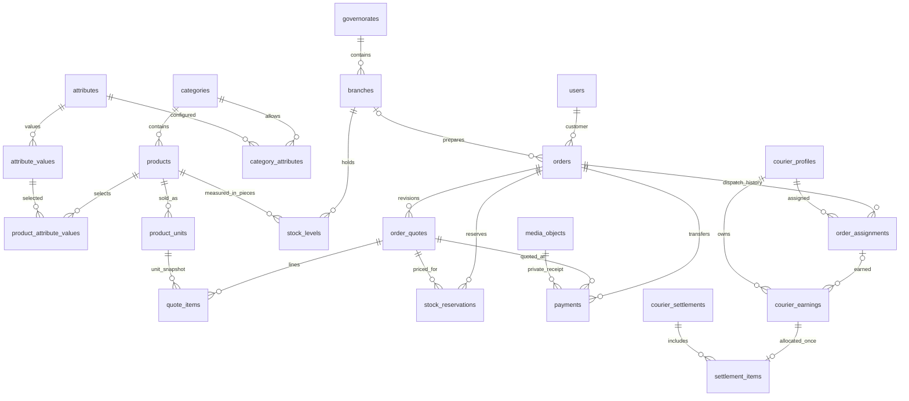

> سجل تاريخي للمراجعة الأولى قبل قرارات المالك؛ لا تعتمد توصياته المخالفة. المرجع الحالي هو REVIEW_00.md في الجذر وOWNER_DECISIONS_PHASE00.md.

# مراجعة المرحلة 00 — تزويد

التاريخ: 2026-10-28. المرجع المفحوص: commit `6dbff74b92005290ca067e263792eb3bc8d84f79`، حزمة 1.1.

## النتيجة

اكتملت مراجعة المرحلة 00. الحزمة أساس مناسب للمشروع، لكنها ليست مخطط إنتاج معتمدًا بعد. توجد تعارضات محددة في دورة التسعيرة وتغيير الفرع وإعادة رفع الإيصال، إضافة إلى قرارات تجارية لم يعتمدها المالك. هذه المراجعة لا تمنح موافقة نيابة عنه ولا تبدأ المرحلة 01.

فُحصت الملفات المئة الواردة في manifest قبل تعديل ذاكرة المرحلة، وكانت مطابقة للأحجام وSHA-256. الفيديوهان في `customer-app/video` وفق طلب المالك. نُفذ SQL على PGlite في الذاكرة وأنشأ فعلًا 56 جدولًا؛ اجتازت الاختبارات المرجعية 22 حالة رفض. أضيفت 17 حالة تشخيص أثبتت السلوك المذكور أدناه. نجاح التشخيص يعني إعادة إنتاج السلوك الحالي، حتى عندما يسمح SQL بعملية يجب أن يمنعها الخادم مستقبلًا.

دليل النتائج: [phase-00-checks.json](phase-00-checks.json). ملخص العمل: [phase-00.md](phase-00.md).

## ما تمت قراءته وما هو معتمد

قُرئت `README.md` و`START_HERE_AR.md` و`MASTER_PROMPT.md` و`remember.md` و`backend/docs/phases/00.md` وجميع مراجعها: `REQUIREMENTS.md` و`DECISIONS.md` و`ARCHITECTURE.md` و`BUSINESS_RULES.md` و`DATABASE.md` و`schema.sql` و`API.md` و`SECURITY_OPERATIONS.md` و`ACCEPTANCE.md`. وفُحصت اختبارات المخطط و`VALIDATION.md` ومواضع أصول العميل ومراجع دمجها.

المعتمد هو طلب المالك و`REQUIREMENTS.md`: متجر واحد بفروع، ثلاثة تطبيقات عربية RTL وخط Tajawal، أسعار وتصفح عامان، حساب مؤكد للطلب، الحبة والكرتون ومخزون فرعي، موافقة العميل على تعديل السعر، دفع بتحويل وإيصال ومراجعة يدوية، إسناد إداري دون رفض من الموصل، عمولة من التوصيل فقط، وصيانة العميل وحده. لا تعدد متاجر أو تتبع حي أو استرداد آلي أو فاتورة PDF للعميل. التقرير الشهري PDF للإدارة ضمن النطاق.

`DECISIONS.md` بالكامل مقترحات؛ وجود حقولها في SQL لا يجعلها معتمدة. لا توجد موافقة مسجلة حتى الآن على تفاصيلها.

## مراجعة المخزون والحبة والكرتون

- كل `products` يمثل SKU بعبوة/مقاس ثابت، وليس منتجًا متعدد المقاسات يشترك في مخزون واحد. `product_units` وحدات بيع للـSKU نفسه، وليست مخزونات مستقلة.
- `stock_levels` رصيد بالحبّات لكل فرع ومنتج. الحر = `on_hand - reserved`، ويجب مراعاة `sellable` ونشاط المنتج والفرع والمحافظة والوحدة.
- مثال المراجعة: كرتونان ×12 +3 حبات =27 حبة. سعر كرتون افتراضي 58000 وحبة 5000 يعطي 131000 ريال قبل التوصيل والخصومات؛ لا يُستنتج سعر الكرتون من الحبة. هذه أرقام اختبار لا أسعار متجر حقيقية.
- الحالة R16 تحققت من 27 حبة ورفضت حجزها في رصيد 26. هذا يثبت الحساب وقيد الرصيد؛ لا يثبت سلامة حجز متزامن من طلبين.
- يجمع الصرف لكل `order/branch/product` في حركة sale واحدة بسبب `one_order_sale`. عند التأكيد: قفل الطلب وصفوف الرصيد بترتيب ثابت، والتحقق من الحجوزات، ثم خفض `on_hand` و`reserved` واستهلاك الحجوزات وكتابة الدفتر وoutbox في معاملة واحدة.
- SQL يمنع السالب والحجز الأكبر من الرصيد وتكرار صرف البيع، لكنه لا يطابق مجموع الحجوزات أو الحركات مع الرصيد تلقائيًا؛ R08 سمحت بانحراف العداد. تحرير الحجز وانتهاؤه والنقل والجرد تتطلب معاملات وخدمة تحقق وتسوية انحراف، لا تحديثًا منفردًا للعداد.
- النقل بين فرعين لا يستهلك المحجوز، ويتطلب صلاحية الفرعين. تاريخ حركة المخزون غير قابل للتعديل أو الحذف. عكس الحركة قيد تعويضي مبرر ومحدود، ولا يفتح إرجاعًا داخل التطبيق.
- تغيير معامل كرتون له تاريخ يجب منعه أو إنشاء وحدة جديدة وأرشفة القديمة. R04 أثبتت أن SQL الحالي لا يمنع التغيير؛ الـsnapshot وحده لا يحمي كل حسابات الحجز إذا قرأت الخدمة المعامل الحالي.

## مراجعة الخصائص والكتالوج

السلسلة `attributes → attribute_values` مع `category_attributes` و`product_attribute_values` صحيحة: المفاتيح المركبة تمنع قيمة تخص خاصية أخرى أو قسمًا لا ينتمي إليه المنتج. المفتاح الأساسي يمنع قيمتين للخاصية المفردة في المنتج. العلامة `brand` قائمة موحدة وليست نصًا حرًا. مقاس آخر يعني SKU أخرى؛ لا وراثة ضمنية لخصائص القسم الأب.

القيد لا يضمن وجود كل خاصية إلزامية أو نشاط القيمة أو خلو شجرة الأقسام من دورة متعددة العقد. R07 سمحت بمنتج يفتقد خاصية required. يلزم فحص اكتمال عند النشر/التفعيل، مع إبقاء المسودة ممكنة بوضوح إذا اختير هذا السلوك. الأرشفة تحفظ الطلبات القديمة، ولا حذف لقيم مستخدمة. عرض الكتالوج بحسب المحافظة يحتاج بيان أن السعر المعروض مبدئي إذا كانت أسعار الفروع تختلف؛ السعر النهائي بعد تعيين الفرع وقبول التسعيرة.

## مراجعة التسعيرة وقبول العميل

التدفق المستهدف: طلب مرتبط بالمالك والعنوان والمحافظة → تحديد فرع واحد → عرض نهائي مرقّم ومحجوز بمهلة → موافقة صاحب الطلب على آخر revision → تحويل وإيصال → مراجعة → تأكيد ذري. الجملة تبدأ ببنود وكميات قبل تسعير الإدارة، ولا تحجز طوال النقاش ولا تحدث أسعار الكتالوج.

تغيير أي بند/سعر/خصم/رسوم/فرع ينشئ revision جديدًا ويبطل صلاحية الموافقة السابقة، مع الاحتفاظ بأثرها التاريخي. أوصي بإعادة الموافقة على تغيير الفرع حتى لو بقي الإجمالي نفسه لأن جهة التنفيذ وsnapshot تغيرا؛ هذه توصية أوضح من شرط تغير الإجمالي وحده وتحتاج إدراجها عند اعتماد التدفق.

SQL يربط `current_quote_id` بالطلب الصحيح (R15)، ويحسب الإجمالي داخل الرأس وحساب كل بند. لكنه لا يفرض أن subtotal يساوي مجموع البنود، أو أن accepted_by هو العميل المالك، أو أن العرض آخر نسخة ولم تنتهِ، أو أن فرعه يطابق فرع التنفيذ الحالي (R05/R09/R10). هذه التزامات خدمة واختبارات معاملات، وليست نتائج حققها المشروع الآن.

## مراجعة الدفع والإيصالات

وصول صورة الإيصال لا يعني وصول المال. الموظف المخول يتحقق خارجيًا، ثم تعتمد الخدمة التحويل مرة واحدة مع مرجع الطلب ونسخة السعر. تجمع التحويلات المعتمدة للطلب مع الاحتفاظ بارتباط كل منها بالتسعيرة التي صدرت وقتها؛ لا تتجاهل المال القديم عند إصدار revision جديد.

شرط التأكيد: قبول آخر عرض صالح، وتطابق مجموع المال المعتمد مع إجماليه، وتوفر المخزون والحجز، وصلاحية الموظف، وعدم وجود تسوية مالية معلقة. النقص يطلب فرقًا، والزيادة توقف التأكيد حتى تسوية يدوية موثقة؛ لا تحول تلقائيًا إلى إيراد أو محفظة داخلية. الطلب ذو إجمالي صفر — إن سمحت به سياسة الخصومات المعتمدة — لا يحتاج إيصالًا صوريًا بقيمة صفر؛ `payments.amount_yer` موجب أصلًا.

SQL يربط الدفع بالطلب والعرض، ويمنع تكرار `(method_id, normalized_receipt_number)` ويلزم هوية وتوقيت مراجعة المدفوعات غير المعلقة. لكنه لا يتحقق من صاحب ملف الإيصال أو خصوصيته أو اكتمال فحصه أو نطاق المحفظة أو انتقال الحالة؛ كل ذلك في الخادم. مخاطر إعادة الرفع وتثبيت بيانات التحويل موضحة في F04/F05.

## مراجعة التوصيل والعمولة والتسويات

التوصيل من الفرع الذي سيجهز الطلب إلى دبوس العنوان. الطريق والتعرفة وطريقة التقريب والخصومات snapshots، فلا يتغير طلب سابق بتعديل إعداد الفرع. تعذر مزود الطريق لا يبرر استعمال الخط المستقيم كسعر طريق؛ مسار المراجعة اليدوية يتطلب سببًا وسعرًا يقبله العميل.

العمولة المقترحة = `round((delivery_yer - delivery_discount_yer) × commission_bps / 10000)`، ولا تدخل المنتجات. مثال اختباري: توصيل 450 وخصم توصيل 50 ونسبة 2000 bps =80 ريالًا؛ هذه ليست نسبة معتمدة لموصل حقيقي. النسبة تحفظ عند الإسناد وتستحق عند التسليم فقط. يجب ضبطها صراحة؛ 0 نسبة مقصودة مسموحة، وNULL تعني غير مضبوطة.

SQL يمنع أكثر من إسناد نشط وأكثر من earning تسليم لكل طلب، ويمنع تخصيص earning مرتين، ويثبت حساب العمولة داخل الإسناد. R14 رفضت earning صفريًا: عند عمولة صفر لا ننشئ هذا الصف، مع ظهور التسليم في التقرير. R11/R12 أثبتتا أن ربط المستحق بالموصل والطلب والمبلغ الصحيحين ومجموع التسوية مسؤولية الخادم. baseline نفسها تنشئ إسنادًا واستحقاقًا لطلب قيد المراجعة؛ نجاحها لا يثبت بوابة confirmed/delivered.

الدفاتر والتسويات غير قابلة للتعديل أو الحذف. إعادة الإسناد المقصودة هي إنهاء الإسناد القديم بـ`ended_at` وإنشاء آخر مع إبقاء التاريخ، وليست حذف السجل كما قد توحي كلمة «تمحو» في قواعد العمل. عكس التسوية يحتاج سجل تعويض صريحًا قبل استعماله ماليًا (F06).

## نتائج التصميم والتعارضات وخطة معالجتها

الأولوية «عالٍ» تعني حل التصميم قبل تنفيذ المسار المتأثر. لا تعني وقوع عطل إنتاجي؛ لا تطبيق إنتاجيًا قائمًا. لم يتغير SQL أو العقد المرجعي في هذه المرحلة.

| الرمز | الأولوية والدليل | النتيجة والأثر | التغيير المقترح وموعده |
|---|---|---|---|
| F01 | عالٍ؛ `API.md` تسعير وسلة، `order_quotes.order_id`؛ R01=23503 | `/checkout/quote` يسبق `POST /orders` بينما العرض والحجز الدائمان يشترطان طلبًا موجودًا. لا يمكن تنفيذ الوصف حرفيًا بهذا SQL. | قبل ربط الطلب في 07/08: اجعل checkout معاينة غير حاجزة، وأنشئ الطلب والعرض النهائي والحجز ذريًا في submit ثم اطلب الموافقة؛ أو صمم checkout session مستقلة إن أُريد حجز قبل submit. التوصية الأولى أبسط، مع توضيح احتمال إعادة التسعير بين المعاينة والإرسال وعدم إخطار الإدارة بمعاينة فقط. |
| F02 | عالٍ؛ `stock_reservations` FK إلى `(orders.id,branch_id)`؛ R02=23503 | تحرير الحجز لا يفك مرجعه التاريخي. تغيير فرع الطلب يفشل حتى والحجز released. `ON UPDATE CASCADE` سيغيّر التاريخ خطأ. | قبل migrations في 05: اربط تاريخ الحجز بالطلب وبثلاثية العرض/الطلب/الفرع الثابتة، مع UNIQUE مناسب على العرض؛ أزل الاعتماد التاريخي على فرع الطلب المتغير. تغيير الفرع يحرر القديم ويحجز الجديد ويولد revision ضمن معاملة، والخدمة تتحقق من فرع العرض الحالي. |
| F03 | عالٍ؛ `quote_items` و`product_units`؛ R04/R05=allowed | وصف البنود بأنها immutable وحظر تعديل تحويل ذي تاريخ غير مفروضين في SQL. يمكن تعديل عرض sent أو تغيير تحويل استُخدم. | حراس كتابة ومعاملات واختبارات في 05/06/08، ومع triggers أو صلاحيات كتابة محددة عند الحاجة. اسمح بتعديل draft فقط؛ لا تغيّر حقائق snapshot بعد الإرسال، وافصل انتقال status وبيانات الموافقة عن حقائق السعر. |
| F04 | عالٍ؛ `payments` UNIQUE؛ R13=23505 | قاعدة «رفض الصورة يسمح بإعادة رفعها» تصطدم بإدراج payment جديدة بنفس الوسيلة والرقم، حتى إذا كان الأصل rejected. | في 05/08: سجل تحويل واحد بالمرجع مع محاولات إيصال/مراجعة محفوظة في جدول تابع؛ إعادة الرفع لنفس التحويل تخص المالك والطلب نفسه ولا تتجاوز كشف التكرار أو تعيد فتح approved. أضف عقد receipt-attempts أو بديلًا مكافئًا، مع idempotency وأثر مراجعة كامل. |
| F05 | عالٍ؛ `API.md` paymentMethod snapshot و`payments.method_snapshot` | بيانات التحويل تُعرض قبل الدفع، لكن snapshot الوحيدة معرفة عند إنشاء payment بعد رفع الإيصال؛ تعديل المحفظة بين العرض والتحويل قد يفقد البيانات التي اتبعها العميل. | في 05/08: احفظ تعليمات تحويل بإصدار مرتبط بالطلب والعرض عند اختيار الوسيلة وقبل إظهار وجهة الدفع، مثل `payment_instructions`؛ الإيصال يرجع إلى هذا السجل بدل إعادة قراءة بيانات الوسيلة الحالية. |
| F06 | عالٍ قبل التسويات/استثناءات الدفع؛ `courier_settlements` و`settlement_items` و`payments` | القيد التعويضي لعكس تسوية مذكور نصًا، لكن لا مرجع أصل/سبب/نوع عكس مخصص في التسويات. معالجة مال زائد أو طلب مرفوض بعد تحويل موصوفة بلا سجل تسوية استثنائية محدد. | صمم قبل 08/09 سجل تسوية يدوية خارجية وإثباتها، وسجل عكس تسوية موصل مرتبطًا بالأصل ومانعًا للتكرار؛ لا حذف allocations ولا بناء نظام استرداد آلي. اعتمد السياسة التجارية أولًا، ثم حدد الجداول/العقود. |
| F07 | متوسط؛ `DATABASE.md` قاموس order_quotes مقابل SQL؛ R03=allowed | القاموس يعرض مساواة حالة accepted بوجود بيانات القبول؛ SQL الفعلي شرط اتجاه واحد فقط. الأول سيمنع حفظ أثر قبول عند superseded/expired. | تصحيح القاموس لتمثيل SQL الحالي، والمحافظة على تاريخ الموافقة. لا تشدد CHECK إلى مساواة. أضف اختبارًا دائمًا عند تنفيذ نسخ العروض في 08. |
| F08 | متوسط؛ `API.md` مقابل المتطلبات | إدارة المحافظ ووسائل التحويل ونسب الموصلين وعضويتهم في الفروع ليست عقود CRUD مفصلة. طلبات الإلغاء والمراجعة الاستثنائية تحتاج حالة ونتيجة محفوظتين. و«حدود استخدام» العروض مذكورة بلا نموذج عدادات. | أكمل OpenAPI في 05–10: methods، couriers/profiles/branches، cancellation review وfinancial exception resolution؛ حدد قاعدة اختيار العرض وحدوده أو أزل الادعاء بحدود غير منفذة. لا تفترض أن جدول نطاق API عقد مكتمل. |
| F09 | متوسط؛ `branches.coverage_radius_m` و`delivery_rules.max_distance_m` | معنى نطاق التغطية عند NULL والعلاقة بين نصف قطر التغطية ومسافة الطريق غير محددين؛ قد يظهر فرع مؤهل بغير قصد. | قبل 07: عرّف نطاقًا هندسيًا أوليًا ومسافة طريق نهائية والحقول المطلوبة قبل تفعيل التوصيل. لا تجعل NULL سماحًا مفتوحًا افتراضيًا دون اعتماد. وثق معنى «متوفر» للمحافظة مقابل أهلية طلب كامل من فرع واحد. |
| F10 | متوسط؛ الحذف ودفاتر التدقيق | snapshots وملاحظات/مرفقات قد تحتوي بيانات شخصية، بينما بعض الدفاتر تمنع التعديل. حذف users مباشرة سيصطدم أيضًا بمراجع التاريخ. | خطة 05/11: تقليل البيانات قبل دخول الدفاتر، schemas للـsnapshots، تعمية مضبوطة للحقول القابلة للمحو وحذف الملفات وفق السياسة، وإبطال الجلسات دون إلغاء التاريخ المالي. لا تمنح UPDATE عامًا على دفاتر التدقيق لحل الخصوصية. |
| F11 | متوسط؛ `IntroScreen.tsx` و`media/rebuild_intro.py` | مرجع IntroScreen يستورد `../media/intro-*.mp4`، وإعادة البناء تكتب في media؛ الملفات الفعلية حسب طلب المالك في video. | في 01 فقط: مواءمة require ومخرجات إعادة التصدير والوثائق إلى `customer-app/video`؛ لا تنقل الفيديوهات أو تكررها من أجل المرجع. لا اختبار أجهزة أو دعم native مثبت الآن. |

### قواعد الخادم المطلوبة وليست تعارضات جديدة

هذه الحدود مصرح بها أصلًا في `DATABASE.md`. لا يصح تقديم سماح SQL فيها كعطل غير متوقع أو كإثبات أن الخدمات تعمل:

| المجال | ما يلزم في التنفيذ والاختبار |
|---|---|
| قبول وتأكيد | صاحب الطلب، آخر revision ونسخة الطلب، انتهاء الصلاحية، مجموع البنود، الفرع/المحافظة/العنوان، سداد مطابق وحجز صالح. R06/R09/R10 توضح غياب هذه البوابات في SQL وحده. |
| المخزون | مجموع الحجوزات الفعالة يطابق reserved والدفتر يطابق on_hand؛ قفل ثابت الترتيب وإعادة محاولة deadlock محدودة؛ لا مضاعفة للحجز بعد إعادة الإرسال. |
| الكتالوج | الخصائص المطلوبة ونشاط القيم والوحدات، ودورات الأقسام، والأرشفة دون إفساد التاريخ. |
| الصلاحيات | action+branch وملكية كل كائن ونوع الحساب؛ نطاق المحافظة يمثل بمنح فروع واضحة في النموذج الحالي؛ X-App لا يمنح أي صلاحية. الموصل لا يرى إيصالات أو بلاغات العميل الكاملة. |
| العمولة | confirmed قبل الإسناد، ثم delivered قبل الاستحقاق، الموصل والطلب والمبلغ مطابقون للإسناد؛ التسوية تخص موصلًا واحدًا ومجموعها مطابق، بما فيه adjustments السالبة المسموحة. |
| منع التكرار | قفل/حجز مفتاح idempotency داخل المعاملة؛ hash مختلف لنفس المفتاح=409؛ النتيجة والدفاتر وoutbox تحفظ ذريًا. UNIQUE وحده لا يطبق سياسة الاستعادة أو انتهاء المفتاح. |
| الجلسات وOTP | تحقق حديث واستخدام واحد وحدود محاولات؛ تدوير refresh ومنع reuse مع سجل عائلة/ربط الإبطال عند تنفيذ الهوية. regex اليمن الحالي تنسيق فقط لا يثبت دعم المشغل أو وصول OTP. |
| التشغيل | lease واستعادة مهام outbox المتوقفة وbackoff وdead-letter، وصيانة customer عبر صلاحيات الخادم واستثناءات محددة. سياسات JSON وإعدادات settings typed ومتحقق منها. |
| الأموال | تقريب صحيح بالريال وbps دون floating point، وتحديد تمثيل bigint في JSON بحدود صريحة أو سلاسل عشرية متفق عليها بالعقد. لا تحويل غير آمن إلى JavaScript Number. |

## القرارات المطلوب اعتمادها من المالك

كل الصفوف التالية «مقترح غير معتمد». لم تُسجل إجابة مفترضة من المالك. الرموز D01–D21 تغطي جميع موضوعات `DECISIONS.md` بالترتيب نفسه. قرارات الحسابات والإطلاق يمكن تأجيل قيمها، لكن لا تُعرض الخدمات كأنها مهيأة.

| الرمز | الموضوع والاقتراح المعروض للاعتماد | توقيت الحسم |
|---|---|---|
| D01 | كلمة مرور ثم OTP لكل دخول تفاعلي، دون OTP لكل refresh؛ دعوات داخلية للموظف والموصل. Adapter لـWhatsApp الرسمي أو SMS، والمزود لم يُختر. | التدفق قبل واجهات الهوية 01/02؛ المزود قبل ربط 05 والإنتاج. |
| D02 | اختيار أقرب فرع بطريق داخل المحافظة يملك كل البنود ويغطي العنوان؛ لا تقسيم الطلب. تغيير الفرع قبل التأكيد بعرض جديد وموافقة جديدة. | قبل 01/02 لتصميم حالات عدم التوفر. |
| D03 | سعر أساسي عام مع override اختياري للفرع؛ النهائي من فرع التنفيذ. بديل الحسم: أسعار موحدة تمامًا بين الفروع. | قبل عرض أسعار الواجهات 02. |
| D04 | SKU ثابت؛ المخزون بالحبّات؛ الكرتون تحويل ثابت يدار كوحدة مؤرخة جديدة عند التغيير بعد الاستعمال. | قبل اعتماد نموذج البيانات والواجهة 01. |
| D05 | العميل يرى توفرًا فقط؛ التوفر يتطلب رصيدًا حرًا لأصغر وحدة مفعلة، ونشاط كل الكيانات. توفر منتجات منفردة في محافظة لا يضمن تجميعها من فرع واحد. | قبل 02. |
| D06 | رسوم الطريق = base + ceil(distance_m/1000) × per_km، أو اختيار proportional مع تقريب لريال. لا تعرفة حقيقية مُدخلة بعد. | طريقة الحساب قبل 02/07؛ القيم قبل التشغيل الفعلي. |
| D07 | فشل الطريق يذهب لتسعير إداري موثق وموافقة العميل، دون اعتماد demo أو خط مستقيم كسعر نهائي. | قبل تصميم checkout والجملة 02. |
| D08 | محافظ/تحويل يدوي، دون نقد أو بوابة آلية في النطاق الحالي؛ نطاق الوسيلة عام أو لفرع. | قبل 02/03؛ أرقام المستفيد قبل الإنتاج. |
| D09 | حجز 30 دقيقة قابل للضبط عند العرض النهائي؛ انتظار مراجعة محدود عند إيصال. **مدة الانتظار بعد الإيصال وسياسة انتهاء العرض أثناءها لم تحددا** وتحتاجان قرارًا، مع منع تكرار الرفع من تمديد الحجز بلا نهاية. | سلوك العدّاد قبل 02؛ القيم والانتقالات قبل 07/08. |
| D10 | نقص المخزون بعد تحويل: يمنع التأكيد، وتراجع الإدارة المال وإعادة الحجز/التسوية الخارجية مع العميل. يلزم تحديد المسؤول ومدة المعالجة وإثبات إنهاء الحالة. | قبل اعتماد مسار الدفع 08؛ حالة الواجهة قبل 02/03. |
| D11 | إلغاء العميل قبل التأكيد ودون تحويل؛ بعد إيصال طلب إلغاء للمراجعة، ولا إلغاء آلي لمدفوع. لا يمكن للنظام التأكد من تحويل غير مبلغ عنه؛ واجهة الإلغاء توضح ذلك ومراجعة الإدارة تستوعب التحويل المتأخر. | قبل 02/03. |
| D12 | حالة سادسة «ملغي» للملغى قبل التأكيد؛ شارات انتظار الموافقة/التحويل/الإيصال داخل قيد المراجعة. هذه زيادة على الحالات الخمس في المتطلبات وتحتاج اعتمادًا صريحًا. | قبل الواجهات 02. |
| D13 | لا تعديل بعد التأكيد في الإصدار الأول؛ الاستثناءات يديرها إجراء موثق بلا تغيير صامت أو إضافة ميزة جديدة. | قبل 02/03. |
| D14 | نسبة لكل موصل من رسوم التوصيل بعد خصم التوصيل، تُثبت عند الإسناد وتستحق مرة عند التسليم؛ لا قيمة افتراضية مختلقة. | قاعدة الحساب قبل 03/04؛ النسب الحقيقية قبل الإسناد الفعلي 09. |
| D15 | UTC للتخزين وAsia/Aden لحدود اليوم/الشهر والمستحقات. | قبل 03/04 والتقارير. |
| D16 | تقييم الطلب مرة واحدة 1–5 وملاحظات؛ لا تقييم منتج/موصل مستقل في الإصدار الأول. | قبل 02. |
| D17 | عرض تلقائي واحد غير متراكم للمنتجات أو التوصيل، والجملة لا تجمع معه تلقائيًا. أوصي بأكبر توفير مؤهل لكامل الطلب، وعند التعادل ترتيب ثابت، مع اعتماد هل المطلوب غير ذلك؛ لا حدود استعمال غير مصممة. | قبل 02/03؛ الخوارزمية والحدود قبل 07. |
| D18 | الصيانة تمنع تصفح الكتالوج والطلبات الجديدة للعميل وتبقي طلباته الجارية والدعم والخصوصية والحذف؛ الإدارة والموصل مستمران. | قبل الواجهات 02/03 ثم التنفيذ 10. |
| D19 | حذف بتحقق حديث وتعمية وحذف ما لا يلزم مع احتفاظ محدود بالمعاملات والتدقيق. مدة الاحتفاظ ومعلومات السياسة لم تعتمد. | بنية الحذف قبل 05؛ السياسة والقيم قبل 11/الإطلاق. |
| D20 | نسخة يومية مشفرة واحتفاظ مبدئي 30 يومًا وتجارب استعادة. لم تحدد بعد خسارة البيانات المقبولة RPO أو مدة الاستعادة RTO أو الميزانية. | قبل تجهيز تشغيل فعلي واختبار الإطلاق 12. |
| D21 | بيانات المحافظات والفرعين والمواقع والتغطية والعمولات والتحويلات والدعم والنطاق والخدمات؛ تُجمع من المالك دون اختلاق. | يمكن متابعة الواجهات ببيانات تجريبية معلّمة بعد طلب المرحلة؛ يلزم الحقيقي قبل الإنتاج. |

الأولوية في رد المالك: اختيار الفرع وأسعار الفروع (D02/D03)، الحبة والكرتون (D04)، طريقة التوصيل والتقريب (D06/D07)، الحجز وانتظار الإيصال (D09/D10)، الإلغاء والحالة السادسة (D11–D13)، الدفع والعمولة (D08/D14)، ثم اعتماد بقية المقترحات أو تعديلها. لا يوجد تعارض يمنع تسليم هذه المراجعة؛ التعارضات الفنية موثقة بخيارات علاج دون افتراض موافقة تجارية.

## قائمة بيانات الإطلاق والخدمات المؤجلة

| المجموعة | المطلوب من المالك/التحقق العملي | الموعد |
|---|---|---|
| الجغرافيا | أسماء المحافظات والفرعين، إحداثيات مؤكدة، تغطية وخدمة فعلية، تعرفة base/per_km وحدود المسافة وحالات خارج التغطية. | قبل تجربة 07 بمواقع حقيقية. |
| الكتالوج | أقسام وقيم ماركات/لزوجة/مقاسات ووحدات وأسعار وأرصدة افتتاحية لكل فرع؛ صور يملك حق استخدامها. | قبل تشغيل كتالوج فعلي في 06. |
| الدفع والموصلون | أسماء الجهات والمستفيدين وأرقام التحويل ونطاقها، صلاحيات المراجعين، نسب كل موصل وفروعه وسياسة الحالات المالية الاستثنائية. | 08/09 قبل تشغيل حقيقي. |
| OTP | اختيار مزود وتحقق فعلي من وصوله للمشغلين اليمنيين والتكلفة والمرسل؛ مفاتيحه في Secrets عند طلب الربط. | 05 قبل إعلان هوية تعمل فعليًا. |
| التخزين | حساب R2 وموارد منفصلة للصور العامة والإيصالات الخاصة وبيئتي التجربة والإنتاج. | 06 عند الربط. |
| الخرائط | تحديد تشغيل Routing أو مزود قابل للتبديل، واختبار مسارات مواقع الفروع والتغطية والإسناد. OpenFreeMap عرض خريطة وليس مزود تسعير طريق. | 07؛ لا شراء أو provisioning في هذه المراجعة. |
| التطبيقات والإشعارات | أسماء الحزم وbundle IDs وحسابات Expo/EAS ومشاريع التطبيقات الثلاثة وFCM/APNs وحسابات المتاجر وأجهزة اختبار. | اختيار IDs قبل build في 01؛ ربط Push/OTA في 10؛ اعتماد الأجهزة في 12. |
| التشغيل | بيانات استضافة يطلبها المالك، دعم ورقم واتساب وبريد ونطاق، تنبيهات ومراقبة ونسخ واستعادة بميزانية معتمدة. | قبل تشغيل خارجي/إطلاق مستقل. التطوير المحلي داخل الحاوية وفق تعليمات المشروع. |
| الخصوصية | هوية الجهة المشغلة ووسائل التواصل ومدد الاحتفاظ ومعالجة الالتزامات المالية أثناء الحذف؛ نص مطابق للخدمات الفعلية. | قبل 11 والإطلاق. |

لا حاجة لأي مفتاح خدمة إضافي لإكمال المرحلة 00. لم نربط OTP أو R2 أو Maps أو Push أو متجرًا، ولم ننشئ قاعدة إنتاج. صلاحية GitHub متاحة بالفعل ومستخدمة لتسليم هذه المرحلة.

## خريطة العلاقات المختصرة

الرسم يوضح العلاقات الرئيسية الموجودة، ولا يمثل كل جدول أو شروط انتقال الحالة. `orders.current_quote_id` مرجع إضافي إلى عرض من الطلب نفسه؛ تحفظ العروض التاريخية كل نسخها.

### جرد المجالات والجداول: 56 جدولًا فعليًا

| المجال | الجداول | العدد |
|---|---|---|
| جغرافيا | governorates, branches | 2 |
| حساب وصلاحيات | users, roles, permissions, role_permissions, staff_grants, courier_profiles, courier_branches, otp_challenges, sessions, addresses | 10 |
| كتالوج وملفات | media_objects, categories, attributes, attribute_values, category_attributes, products, product_attribute_values, product_images, product_units, branch_unit_prices | 10 |
| مخزون | stock_levels, stock_transfers, stock_transfer_items, stock_reservations, stock_movements | 5 |
| تسعير وطلبات ودفع | delivery_rules, payment_methods, promotions, orders, order_request_items, order_quotes, quote_items, payments, order_events | 9 |
| إسناد وعمولات | order_assignments, courier_earnings, courier_settlements, settlement_items | 4 |
| جودة ومحتوى | order_reviews, complaints, customer_flags, banners | 4 |
| إشعارات | push_tokens, notification_campaigns, notification_inbox, notification_deliveries, outbox_events | 5 |
| تشغيل وخصوصية | customer_maintenance, app_releases, settings, deletion_requests, audit_logs, idempotency_records, report_jobs | 7 |

## خطة الملفات بعد هذه المراجعة

هذه خطة فقط للمراحل التي سيطلبها المالك لاحقًا؛ لم تُنشأ هياكل التطبيق أو migrations أو API في المرحلة 00.

| المرحلة | الملفات/المجالات المتوقعة | الشرط والمراجعة |
|---|---|---|
| متابعة 00 | `DECISIONS.md` و`REVIEW_00.md` و`remember.md` وتقرير المرحلة | تسجيل ردود المالك نصًا، وتصحيح القاموس والعقود المرجعية وفق القرارات قبل البناء عليها. |
| 01 | إعدادات Expo/TypeScript وpackage/lock لكل تطبيق، routing/theme/fonts؛ مواءمة `customer-app/integration/IntroScreen.tsx` و`media/rebuild_intro.py` إلى video | طلب منفصل بعد مراجعة 00؛ اختيار إصدارات متوافقة وقت التنفيذ. إعداد backend قد يقتصر على scaffold كما تطلب 01 دون قاعدة أو منطق مراحل 05+. |
| 02–04 | شاشات التطبيقات الثلاثة وfixtures تجريبية معلّمة وتقارير الواجهات | اعتماد رحلة الفرع/الأسعار/الموافقة/الحجز والإلغاء؛ لا ربط مزود إنتاجي. مراجعة الواجهات قبل الخادم. |
| 05 | migrations لاحقة بعد القرار، `backend/src` للهوية والصلاحيات والعقود typed وOpenAPI واختبارات DB | حل F02 وتصميم F04/F05/F06، وتصحيح F07 دون محو قبول قديم، وتوثيق القيود التي ينفذها الخادم. |
| 06–07 | كتالوج/مخزون/تخزين وdelivery-pricing/routing/promotions | حراس تحويل الوحدات، أقفال المخزون، قرار معاينة checkout مقابل الحجز F01، ونطاق التغطية F09. |
| 08 | orders/quotations/payments ومراجعات الإلغاء والاستثناءات | معالجة F01/F03/F04/F05، مجموع المال المعتمد ونسخ القبول والحجز وحالات التسوية. |
| 09 | dispatch/commissions/settlements/reviews/flags | لا استحقاق قبل التسليم، وصحة مالك earning والتسوية وتعويضاتها F06. |
| 10–12 | الإشعارات والصيانة والإصدارات والتقارير والحذف واختبارات إطلاق | تفعيل الخدمات بحسابات المالك عند طلبها، واختبارات أجهزة وتزامن واستعادة فعلية. لا نشر عام ضمن مراجعة 00. |

## الفحوص وحدود النتيجة

| الفحص | النتيجة الفعلية |
|---|---|
| حزمة الإدخال | 100/100 تطابق الحجم وSHA-256 قبل تعديل remember؛ الفيديوهان متحققان في video. الأرشيف القديم المبتور محفوظ كمرجع، والمشروع المستعاد كامل. |
| `npm test` في backend/reference-tests | exit 0؛ 22 اختبار رفض لقيود SQL. |
| `node phase-00-review.mjs` | exit 0؛ 56 جدولًا بعد استعلام pg_tables، و17 ملاحظة سلوك متوقعة موثقة، منها قيود تعمل وفجوات مقصودة وتعارضات. |
| قابلية الإعادة | `package-lock.json` يثبت PGlite 0.5.12؛ التثبيت عبر `npm ci --ignore-scripts --no-audit --no-fund`. |
| لم ينفذ | تطبيق أو خادم أو migration إنتاجي، أنواع/build Expo، محاكاة أجهزة، اختبارات تزامن PostgreSQL متعدد الاتصالات، RBAC/API أو ربط مزود. لا تُفهم هذه المراجعة كاجتياز أي منها. |

سبب الحاجة إلى معاملات منفصلة عن CHECK يتفق مع [توثيق PostgreSQL للقيود](https://www.postgresql.org/docs/current/ddl-constraints.html): القيود الصفية لا تكفي لقواعد تجمع بيانات عبر جداول. وخطة قفل الطلب/المخزون تعتمد [توثيق أقفال الصفوف](https://www.postgresql.org/docs/current/explicit-locking.html). روجعا في 2026-10-28؛ التحقق المحلي أعلاه هو دليل السلوك الفعلي لهذا SQL، ولم يختر إصدار PostgreSQL إنتاجيًا بعد.

اكتملت مخرجات مراجعة 00، واعتماد القواعد والتصميم ما زال بيد المالك. الخطوة التالية المسموحة هي رد المالك على القرارات أو إصلاحات داخل 00؛ لا تبدأ 01 دون رسالة منفصلة تطلبها.
