# صور مراجعة المرحلة02

لقطات حقيقية من تصدير Expo web لنفس تطبيق العميل. ليست mockups أو اختبار جهاز Android/iOS. البيانات والخرائط والتحويلات محاكاة محلية معلّمة. [التقرير](../phase-02.md) — [نتائج الجولة](browser-results.json) — [فحص360](edge-results.json).

## نماذج من الرحلة

| الواجهة | فاتح390 | مظلم390 |
|---|---|---|
| الرئيسية | 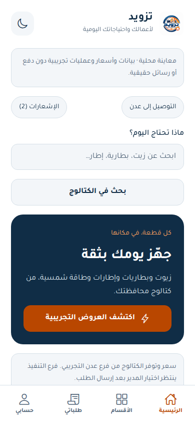 | 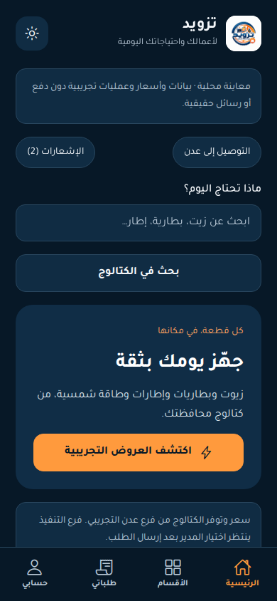 |
| السلة والجملة | 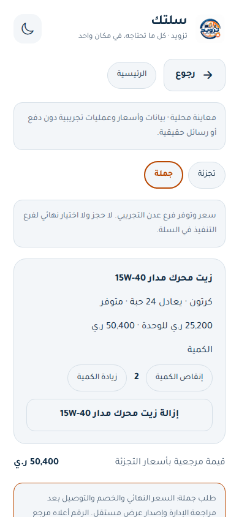 | 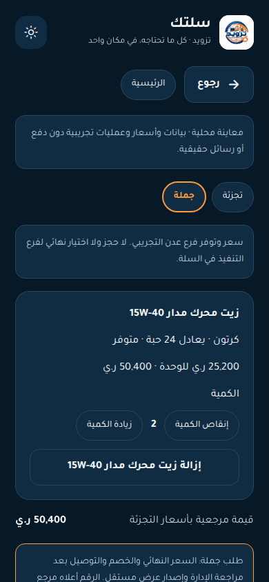 |
| مقارنة تغيير الفرع | 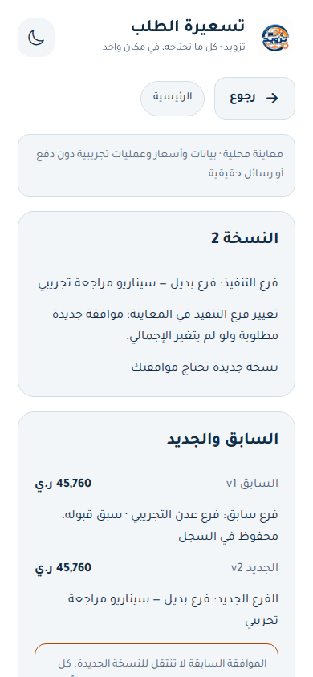 | 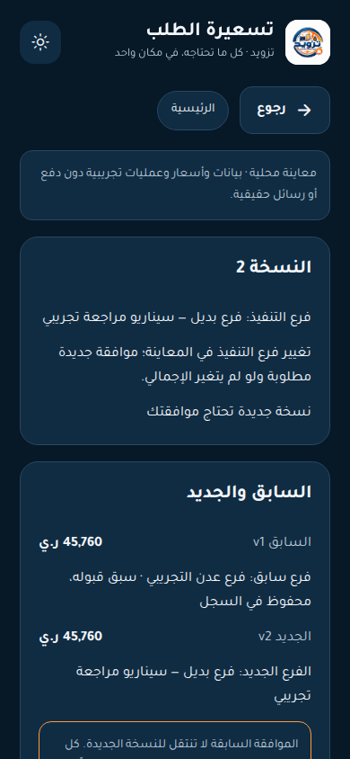 |
| رفض الصورة وإعادة لنفس التحويل | 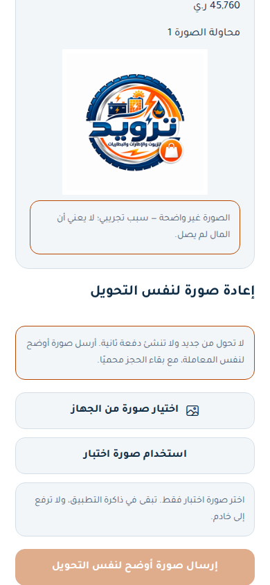 | 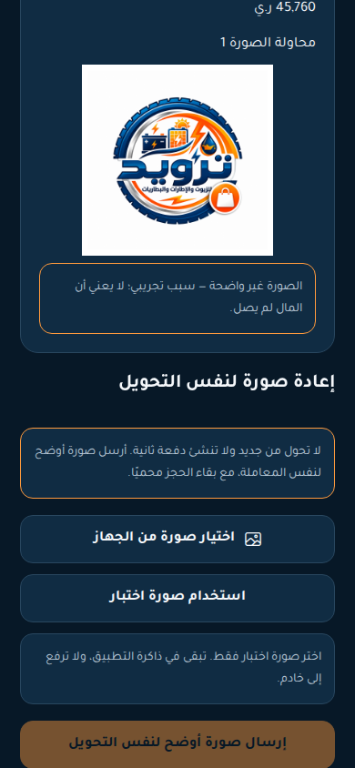 |
| حالة الخطأ | 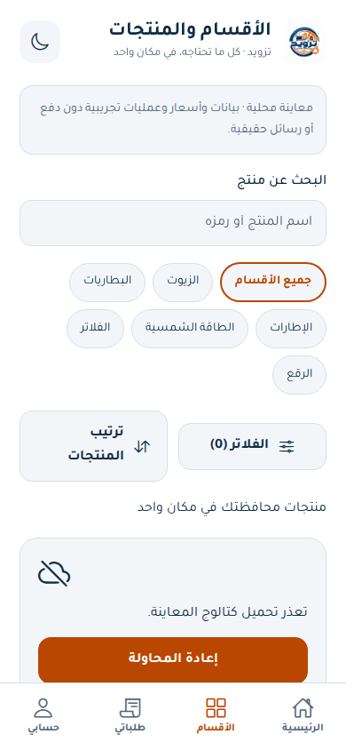 | 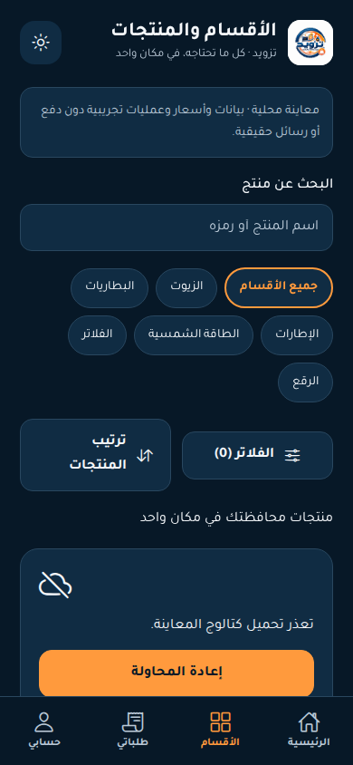 |
| الصيانة | 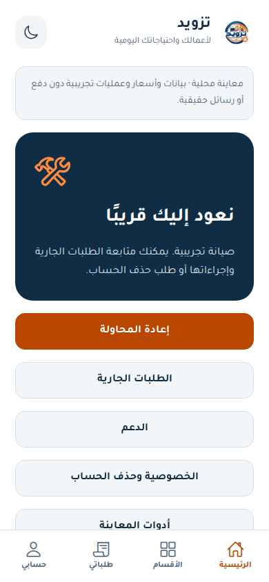 | 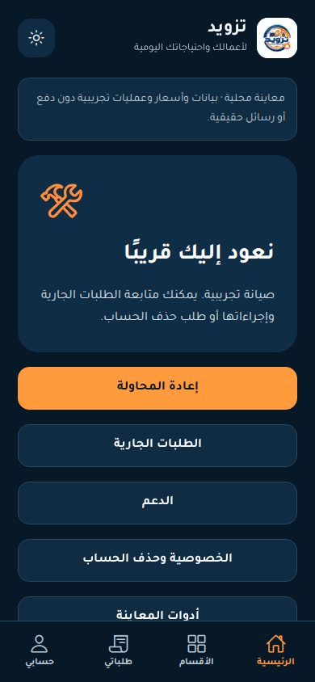 |

## جميع الشاشات والمقاسات

| الشاشة | فاتح390 | مظلم390 | فاتح1024 | مظلم1024 |
|---|---|---|---|---|
| اختيار المحافظة | [صورة](province-light-390.png) | [صورة](province-dark-390.png) | [صورة](province-light-1024.png) | [صورة](province-dark-1024.png) |
| الرئيسية | [صورة](home-light-390.png) | [صورة](home-dark-390.png) | [صورة](home-light-1024.png) | [صورة](home-dark-1024.png) |
| فلاتر القسم | [صورة](filters-light-390.png) | [صورة](filters-dark-390.png) | [صورة](filters-light-1024.png) | [صورة](filters-dark-1024.png) |
| المنتج والوحدات | [صورة](product-light-390.png) | [صورة](product-dark-390.png) | [صورة](product-light-1024.png) | [صورة](product-dark-1024.png) |
| السلة والجملة | [صورة](cart-light-390.png) | [صورة](cart-dark-390.png) | [صورة](cart-light-1024.png) | [صورة](cart-dark-1024.png) |
| الدخول | [صورة](auth-light-390.png) | [صورة](auth-dark-390.png) | [صورة](auth-light-1024.png) | [صورة](auth-dark-1024.png) |
| العنوان والخريطة | [صورة](address-light-390.png) | [صورة](address-dark-390.png) | [صورة](address-light-1024.png) | [صورة](address-dark-1024.png) |
| معاينة الإرسال | [صورة](checkout-light-390.png) | [صورة](checkout-dark-390.png) | [صورة](checkout-light-1024.png) | [صورة](checkout-dark-1024.png) |
| التسعيرة | [صورة](quote-light-390.png) | [صورة](quote-dark-390.png) | [صورة](quote-light-1024.png) | [صورة](quote-dark-1024.png) |
| مقارنة تغيير الفرع | [صورة](quote-revision-light-390.png) | [صورة](quote-revision-dark-390.png) | [صورة](quote-revision-light-1024.png) | [صورة](quote-revision-dark-1024.png) |
| تعليمات التحويل | [صورة](payment-light-390.png) | [صورة](payment-dark-390.png) | [صورة](payment-light-1024.png) | [صورة](payment-dark-1024.png) |
| الحجز المحمي بعد الإيصال | [صورة](receipt-protected-light-390.png) | [صورة](receipt-protected-dark-390.png) | [صورة](receipt-protected-light-1024.png) | [صورة](receipt-protected-dark-1024.png) |
| رفض الصورة وإعادة لنفس التحويل | [صورة](receipt-rejected-light-390.png) | [صورة](receipt-rejected-dark-390.png) | [صورة](receipt-rejected-light-1024.png) | [صورة](receipt-rejected-dark-1024.png) |
| الطلبات | [صورة](orders-light-390.png) | [صورة](orders-dark-390.png) | [صورة](orders-light-1024.png) | [صورة](orders-dark-1024.png) |
| التقييم | [صورة](rating-light-390.png) | [صورة](rating-dark-390.png) | [صورة](rating-light-1024.png) | [صورة](rating-dark-1024.png) |
| البلاغ | [صورة](complaint-light-390.png) | [صورة](complaint-dark-390.png) | [صورة](complaint-light-1024.png) | [صورة](complaint-dark-1024.png) |
| الإشعارات | [صورة](notifications-light-390.png) | [صورة](notifications-dark-390.png) | [صورة](notifications-light-1024.png) | [صورة](notifications-dark-1024.png) |
| حالة التحميل | [صورة](catalog-loading-light-390.png) | [صورة](catalog-loading-dark-390.png) | [صورة](catalog-loading-light-1024.png) | [صورة](catalog-loading-dark-1024.png) |
| حالة الفراغ | [صورة](catalog-empty-light-390.png) | [صورة](catalog-empty-dark-390.png) | [صورة](catalog-empty-light-1024.png) | [صورة](catalog-empty-dark-1024.png) |
| حالة الخطأ | [صورة](catalog-error-light-390.png) | [صورة](catalog-error-dark-390.png) | [صورة](catalog-error-light-1024.png) | [صورة](catalog-error-dark-1024.png) |
| الصيانة | [صورة](maintenance-light-390.png) | [صورة](maintenance-dark-390.png) | [صورة](maintenance-light-1024.png) | [صورة](maintenance-dark-1024.png) |
| التحديث الإجباري | [صورة](update-required-light-390.png) | [صورة](update-required-dark-390.png) | [صورة](update-required-light-1024.png) | [صورة](update-required-dark-1024.png) |
| طلب حذف الحساب | [صورة](delete-request-light-390.png) | [صورة](delete-request-dark-390.png) | [صورة](delete-request-light-1024.png) | [صورة](delete-request-dark-1024.png) |

## فحوص إضافية

- [مسار النقد](cash-payment-light-390.png) و[تحصيل مستقل ثم تسليم](cash-delivered-light-390.png).
- [سحب الخريطة التخطيطية360](map-drag-light-360.png)، [الإلغاء دون إيصال](cancelled-light-360.png)، [محافظة بلا فرع](province-unconfigured-light-360.png).
- [QR العميل](customer-qr.png)، [QR الإدارة](admin-qr.png)، [QR الموصل](courier-qr.png). الروابط مؤقتة ووقت الفحص في [دليل الأنفاق](../phase-02-tunnels.json).
- صور الإدارة والموصل والافتتاح في المجلد دليل تراجع01 فقط. الصوت والخلفية وlauncher/splash الأصلي تحتاج جهاز المالك.
